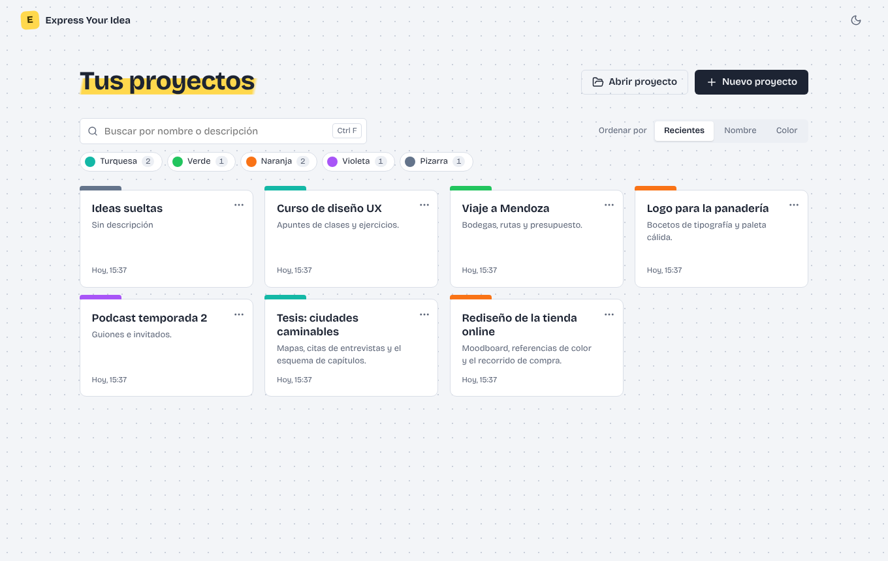
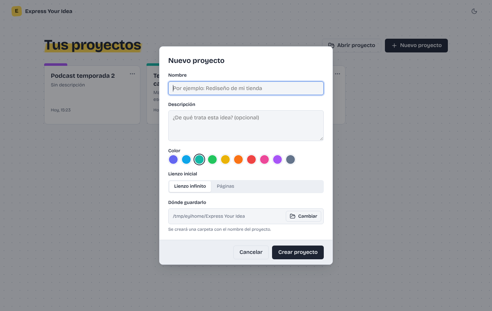
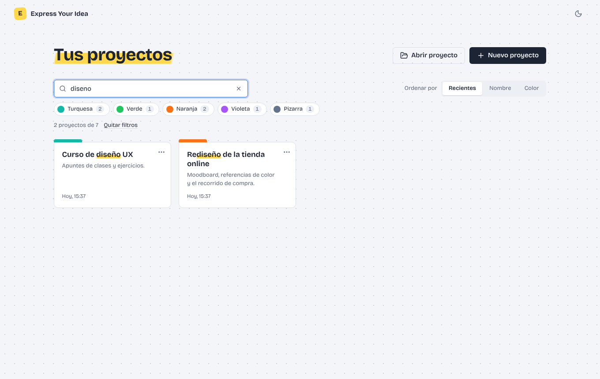
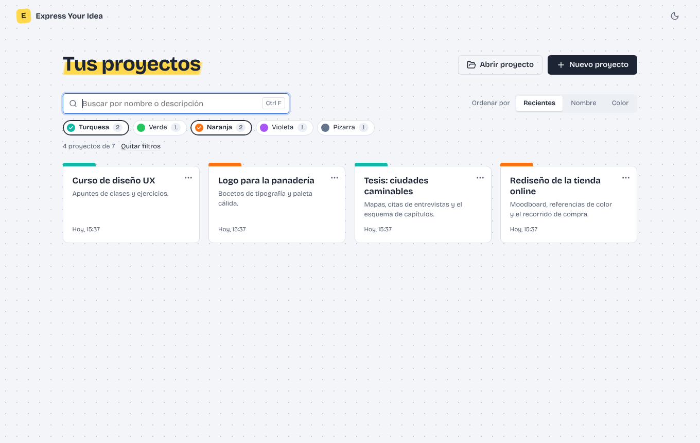
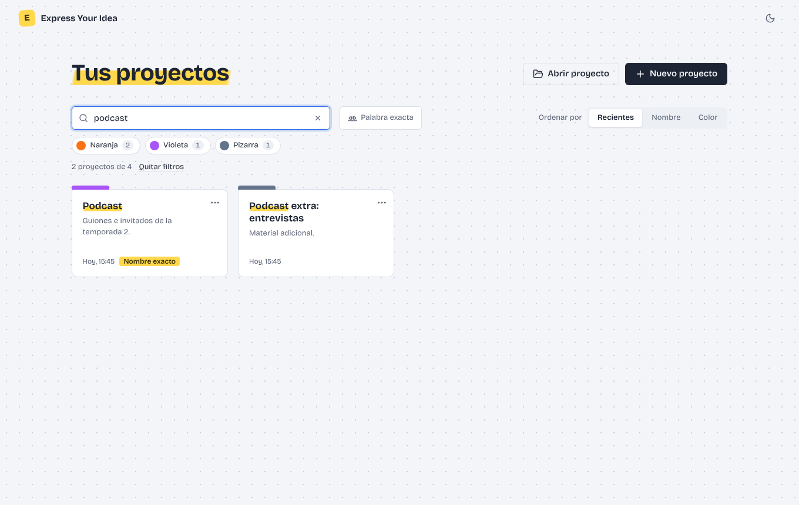
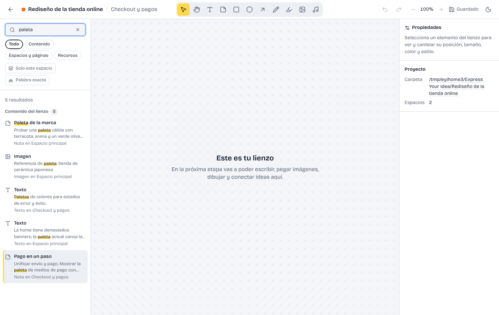
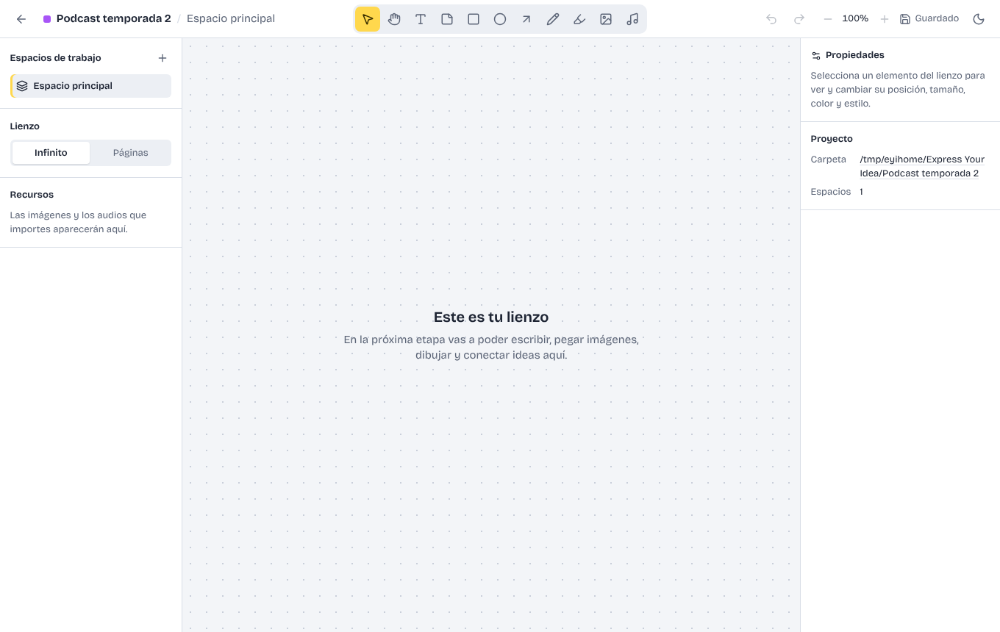
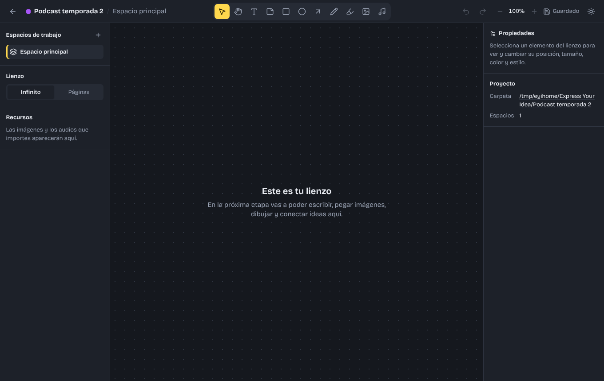

<p align="center">
  
</p>

<h1 align="center">Express Your Idea</h1>

<p align="center">
  Pizarra digital para volcar ideas, ordenarlas a tu ritmo y retomarlas cuando quieras.<br />
  Aplicación de escritorio para Windows que funciona sin internet y guarda todo en tu computadora.
</p>

<p align="center">
  
</p>

---

## Qué es

**Express Your Idea** es un espacio de trabajo visual donde cada idea vive en su propio
proyecto. Dentro de cada proyecto hay un lienzo donde puedes combinar **textos, notas, imágenes,
dibujos, formas, conexiones, resaltados y audios**, y organizarlos libremente o en páginas.

> **Principio rector:** una idea no tiene por qué comenzar ordenada.
> Express Your Idea permite que encuentre su propia estructura.

Está pensada para que la use **cualquier persona**, sin conocimientos técnicos:

- Se instala con un instalador en español, sin permisos de administrador.
- **No necesita internet, cuentas ni programas extra.** La base de datos (SQLite) viaja dentro de la app.
- Cada proyecto es **una carpeta** en tu computadora: se puede copiar, respaldar o llevar a otra PC.
- Los errores se explican en lenguaje simple y con una acción concreta.

## Estado del proyecto

| Etapa | Contenido | Estado |
|---|---|---|
| 1. Fundamentos | Monorepo, Electron seguro, SQLite con migraciones, gestión de proyectos y espacios, búsqueda de proyectos (exacta y por color), buscador interno por proyecto, tema claro/oscuro, ayuda, instalador de Windows | ✅ Terminada |
| 2. Lienzo | Lienzo infinito, selección, zoom, textos y notas con formato (negrita, cursiva, subrayado, resaltado), formas, deshacer/rehacer | ⏭ Siguiente |
| 3. Contenido visual | Imágenes, dibujo libre, resaltador, conectores, guías inteligentes, panel de recursos | Planificada |
| 4. Organización | Páginas, marcos y contenedores, grupos, panel de capas, panel de propiedades | Planificada |
| 5. Persistencia, audio y exportación | Guardado automático, copias de respaldo, audio, exportar a PDF e imagen, formato portable `.eyi` | Planificada |
| 6. Versión web | La misma app en el navegador, para que otras personas la usen o la descarguen | Planificada |
| 7. Calidad y entrega | Firma de código, actualizaciones automáticas, pruebas en Windows | Planificada |

El alcance completo está en la [definición del MVP 0.1](docs/MVP-0.1.md). Las decisiones tomadas
y las que quedan por cerrar, en [Arquitectura y decisiones](docs/ARQUITECTURA-Y-DECISIONES.md).

## Funciones disponibles hoy

### Proyectos

- Crear proyectos con nombre, descripción, color identificador, carpeta de destino y tipo de lienzo inicial.
- Abrir, editar y eliminar proyectos. **Eliminar los envía a la Papelera de reciclaje**: siempre se pueden recuperar.
- Lista de recientes que avisa si una carpeta se movió o se borró.
- Varios **espacios de trabajo** por proyecto, cada uno con **lienzo infinito** o **páginas**.

<p align="center">
  
</p>

### Búsqueda de proyectos

- Busca por nombre y descripción, **sin importar tildes ni mayúsculas** («diseno» encuentra «Rediseño»).
- **Palabra exacta**: solo palabras completas. **"Entre comillas"**: una frase exacta.
- El proyecto cuyo nombre coincide exactamente aparece primero con la marca **Nombre exacto**.
- **Filtro por color** (uno o varios, con contador) y orden por recientes, nombre o color.
- Las coincidencias se **resaltan** dentro de cada ficha. Atajo: **Ctrl + F**.

| Búsqueda con resaltado | Filtro por varios colores | Nombre exacto primero |
|---|---|---|
|  |  |  |

### Buscador interno de cada proyecto

Separado de la búsqueda de proyectos: con un proyecto abierto, **Ctrl + F** busca palabras
clave **dentro de ese proyecto**.

- Busca en textos, notas, títulos, pies de imagen y palabras clave de los elementos, y en los
  nombres de páginas, espacios de trabajo e imágenes o audios importados.
- Filtros por tipo (**Todo**, **Contenido**, **Espacios y páginas**, **Recursos**),
  **Solo este espacio** y **Palabra exacta**. Las frases entre comillas también funcionan.
- Resultados agrupados, con un fragmento del texto y la palabra resaltada. Al hacer clic se abre
  el espacio donde está.
- Funciona con un índice de búsqueda dentro del propio proyecto que se actualiza solo.

<p align="center">
  
</p>

### Espacio de trabajo

Cuatro sectores, como define el MVP: **barra lateral** (espacios, lienzo, recursos y buscador),
**barra superior** (herramientas, deshacer/rehacer, zoom, guardado), **lienzo central** y
**panel de propiedades**. Las herramientas del lienzo se activan en la Etapa 2.

| Tema claro | Tema oscuro |
|---|---|
|  |  |

### Además

- **Tema claro y oscuro**, recordado entre sesiones.
- **Ayuda** dentro de la app: dónde se guarda el trabajo, cómo llevarlo a otra PC, cómo buscar y cómo recuperar algo eliminado.
- **Mensajes de error comprensibles** y registro técnico aparte (`%APPDATA%\Express Your Idea\logs\main.log`).

Más capturas en [`docs/images`](docs/images).

## Instalar (para usar la app)

1. Descarga `ExpressYourIdea-Setup-<versión>.exe`.
2. Haz doble clic y sigue los pasos. Si Windows muestra **«Windows protegió su PC»**, elige
   **Más información → Ejecutar de todas formas** (aparece porque el instalador todavía no tiene
   firma digital).
3. Listo: la app se abre sola y queda un acceso directo en el escritorio.

La [Guía de uso](GUIA-DE-USUARIO.md) explica todo paso a paso, sin tecnicismos.

## Desarrollar

Requisitos: **Node.js 22 o superior**. No hace falta Visual Studio ni compilar nada.

```bash
git clone https://github.com/Migarzabal024/EXPRESS-YOUR-IDEA.git
cd EXPRESS-YOUR-IDEA
npm install
npm run dev        # abre la app en modo desarrollo
```

| Comando | Qué hace |
|---|---|
| `npm run dev` | Abre la aplicación con recarga en caliente (la primera vez descarga Electron, unos 100 MB) |
| `npm test` | Ejecuta las pruebas (50 pruebas: proyectos, base de datos, búsqueda, filtros, errores) |
| `npm run typecheck` | Verifica los tipos de TypeScript en todo el monorepo |
| `npm run build` | Compila la aplicación |
| `npm run dist:win` | Genera el instalador de Windows en `apps/desktop/release/` |
| `npm run db:generate` | Genera una migración después de cambiar el esquema |

Todos los detalles (estructura, seguridad, formato de proyecto, instalador) están en la
[Guía de desarrollo](docs/DESARROLLO.md).

## Cómo está construido

| Capa | Tecnología |
|---|---|
| Escritorio | Electron 45 |
| Interfaz | React 19 + TypeScript |
| Compilación | Vite 8 + electron-vite |
| Estado | Zustand |
| Base de datos | SQLite (better-sqlite3) + Drizzle ORM, búsqueda con FTS5 |
| Validación | Zod |
| Instalador | electron-builder (NSIS) |
| Próximas etapas | Konva (lienzo), Tiptap (texto enriquecido), WaveSurfer.js (audio) |

```
EXPRESS-YOUR-IDEA/
├─ packages/
│  ├─ core/            Dominio, casos de uso, búsqueda y contrato de API (sin dependencias de plataforma)
│  ├─ storage-sqlite/  Persistencia: SQLite + Drizzle + carpetas de proyecto + índice de búsqueda
│  └─ editor/          Interfaz React, independiente de Electron (reutilizable en la versión web)
├─ apps/
│  └─ desktop/         Electron: proceso principal, preload seguro, IPC e instalador
├─ docs/               MVP, arquitectura, guía de desarrollo e imágenes de referencia
└─ GUIA-DE-USUARIO.md  Guía para quien instala la app
```

**Arquitectura en cuatro capas:** presentación (`editor`), aplicación y dominio (`core`) e
infraestructura (`storage-sqlite`, `apps/desktop`). La interfaz nunca toca el disco: solo habla
con una API (`EyiApi`) que en escritorio implementa Electron y que en la web implementará el
navegador. Así la versión web reutiliza el mismo editor.

**Cada proyecto es una carpeta portable:**

```
Mi proyecto/
├─ manifest.json          Identificador y versiones de formato y de esquema
├─ database/project.db    Todo el contenido del lienzo
├─ assets/images/  assets/audio/  assets/documents/
├─ backups/
└─ exports/
```

**Seguridad:** aislamiento de contexto y sandbox en Electron, lista blanca de canales IPC,
validación de cada entrada con Zod, rutas de proyecto autorizadas solo desde diálogos nativos y
política de seguridad de contenido estricta.

## Documentación

- [Guía de uso](GUIA-DE-USUARIO.md): para quien instala la app.
- [Guía de desarrollo](docs/DESARROLLO.md): estructura, comandos, seguridad e instalador.
- [Arquitectura y decisiones](docs/ARQUITECTURA-Y-DECISIONES.md): qué se decidió, por qué y qué falta definir.
- [Definición del MVP 0.1](docs/MVP-0.1.md): alcance funcional completo del proyecto.
